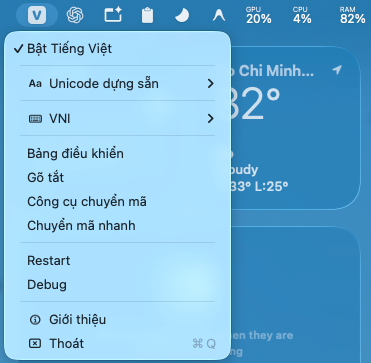
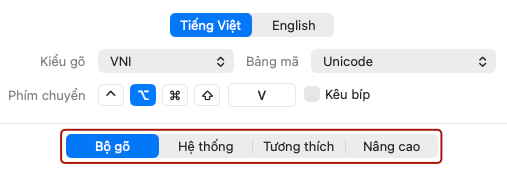
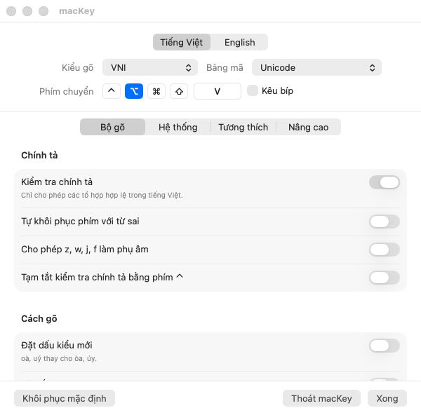
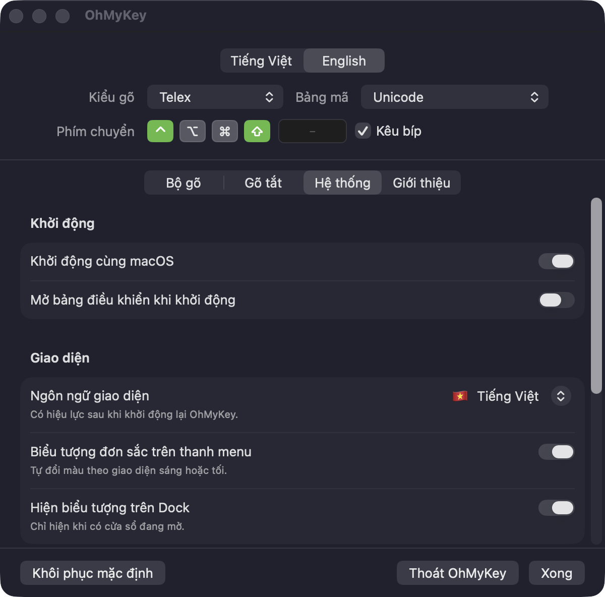
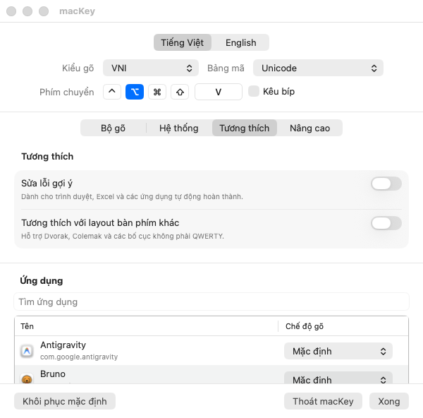
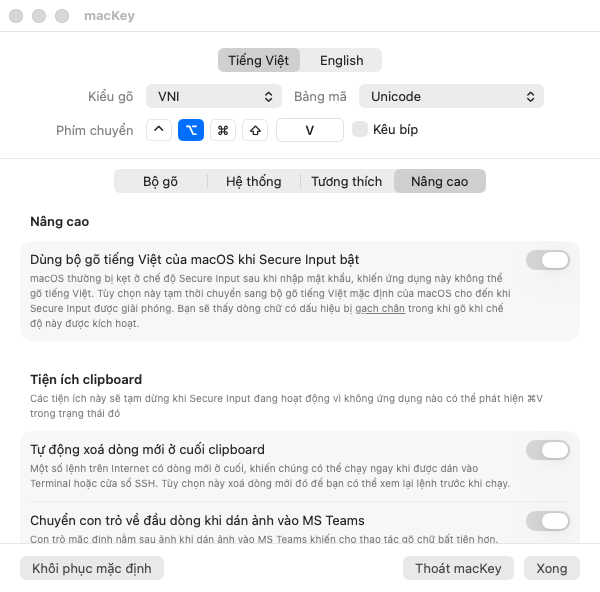
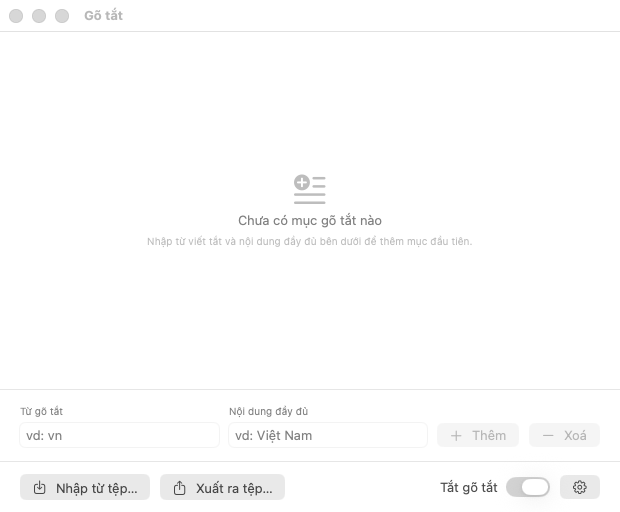
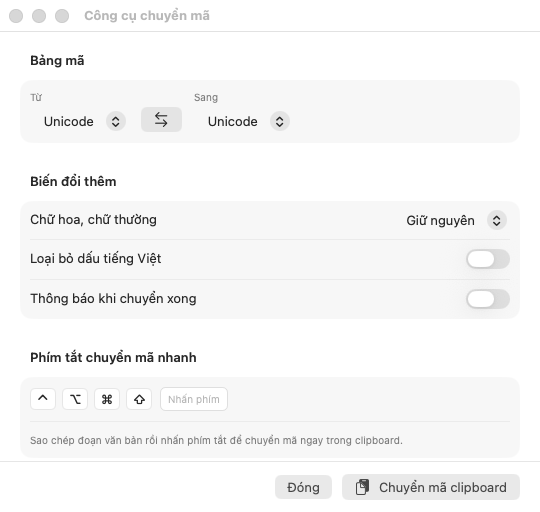
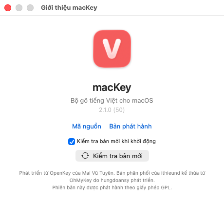
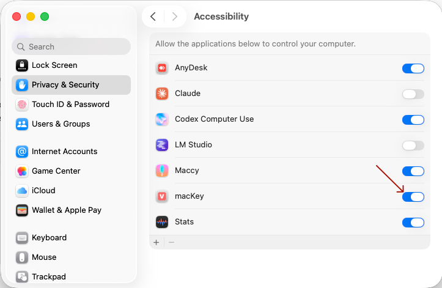

<div align="center"></div>

<div align="center">

# macKey

**Bộ gõ tiếng Việt cho macOS.**

macKey là bản fork của [OhMyKey](https://github.com/hungdoansy/OhMyKey) do [hungdoansy](https://github.com/hungdoansy) phát triển; OhMyKey lại dựa trên [OpenKey](https://github.com/tuyenvm/OpenKey).

Dự án giữ lại phần giao diện macOS được viết lại bằng SwiftUI, thay đổi bố cục trang cấu hình và cải thiện một số điểm chưa hoàn thiện giúp bộ gõ hoạt động ổn định hơn -> **khắc phục hoàn toàn lỗi gõ chữ tiếng Việt chập chờn kinh điển trên macOS**.

[](#yêu-cầu)
[](LICENSE)
[](https://github.com/tuyenvm/OpenKey)

[Thay đổi của bản fork](#thay-đổi-của-bản-fork) · [Tính năng](#tính-năng) · [Yêu cầu](#yêu-cầu) · [Cài đặt](#cài-đặt) · [Cấu trúc dự án](#cấu-trúc-dự-án) · [Credits](#credits) · [License](#license)

</div>

---

## Thay đổi của bản fork

### Cải tiến trong macKey

* **Cải tiến dropdown menu của ứng dụng**: thu gọn các tùy chọn cùng loại theo nhóm giúp dropdown gọn gàng, dễ nhìn hơn

<div align="center"></div>

* **Cải tiến layout trang cấu hình dứng dụng**: cung cấp 4 thẻ cấu hình chính: Bộ gõ, Hệ thống, Tương thích, và Nâng cao

<div align="center"></div>

* **Cấu hình tương thích**: bổ sung tùy chọn Chế độ gõ cho từng ứng dụng khác nhau, bạn có thể tùy chỉnh chế đỗ gõ riêng cho từng ứng dụng tùy vào tính chất của ứng dụng để tăng khả năng tương thích. VD: gõ tiếng Việt trong Microsoft Teams sẽ ổn định hơn với chế độ 'Dán từ bộ nhớ tạm'.
* **Tùy chọn Nâng cao**: bổ sung các tùy chọn nâng cao giúp giải quyết các vấn đề đặc thù trên macOS.

  * **Dùng bộ gõ tiếng Việt của macOS khi Secure Input bật**: khi bạn dùng các bộ gõ tiếng Việt trên Mac, lâu lâu bạn sẽ gặp hiện tượng vừa mới gõ tiếng Việt bình thường thì tự dưng lại không gõ được nữa, dù có thử ở bất kỳ ứng dụng nào. Nguyên nhân mà mình phát hiện ra là ở thời điểm đó chúng ta đã vào một form đăng nhập nào đó và có tương tác với ô nhập mật khẩu. Thao tác này khiến cho macOS tự động bật Secure Input lên để chặn tất cả các ứng dụng khác soi/log mật khẩu mà người dùng đang gõ để bảo vệ mật khẩu của của người dùng. Điều này đồng nghĩa với việc macKey cũng như các ứng dụng gõ tiếng Việt khác đều không còn quyền truy cập vào key stroke event, khiến cho nó trở nên vô tác dụng. Vấn đề là Secure Input sẽ không tự động tắt ngay sau khi bạn hoàn tất thao tác đăng nhập hay gõ mật khẩu mà đôi lúc nó bị kẹt ở đó cho đến khi nào bạn Logout và Login lại user trên máy Mac, khiến cho trải nghiệm soạn văn bản lúc này trỡ nên rất là ức chế. Bật tùy chọn nâng cao này giúp macKey chủ động chuyển sang bộ gõ tiếng Việt mặc định của macOS khi Secure Input đang được bật, giúp trải nghiệm soạn văn bản của bạn trở nên liền lạc, không còn bị gián đoạn như trước nữa.
  * **Các tùy chọn nâng cao khác khi làm việc với dữ liệu đã copy trong Clipboard**: cung cấp các tiện ích nâng cao khi bạn copy/paste từ Clipboard. Bạn có thể bật lên để nâng cao trải nghiệm, tuy nhiên cần lưu ý là các tùy chọn này không thể hoạt động được khi Secure Input của macOS đang bật. Nguyên nhân đã được nói rõ ở bên trên.

### Kế thừa bản cập nhật của OhMyKey

Bộ máy gõ tiếng Việt của OpenKey không thay đổi. Các thay đổi dưới đây đều thuộc phần macOS.


|                                           |                                                                                                                                                                                        |
| ----------------------------------------- | -------------------------------------------------------------------------------------------------------------------------------------------------------------------------------------- |
| **Giao diện viết lại bằng SwiftUI**   | Storyboard cũ đặt cứng khung cho 118 control, khiến nhãn tiếng Việt dài bị cắt giữa từ và bố cục vỡ ở cỡ chữ khác. Bốn cửa sổ nay tự co giãn theo nội dung. |
| **Tiếng Anh và tiếng Việt**           | Mọi chuỗi hiển thị nằm trong`Localizable.xcstrings`. Chọn ngôn ngữ giao diện trong **System → Appearance**: theo hệ thống, Tiếng Việt hoặc English.                     |
| **Bảng điều khiển thay cho hộp tab** | Bảng điều khiển dùng segmented picker thay cho`TabView`, loại bỏ khung lồng trong khung của macOS.                                                                            |
| **Biểu tượng mới**                    | Icon ứng dụng và icon thanh menu dùng chung mô-típ hình vuông bo góc với ký tự khoét rỗng, đặt bằng SF Rounded.                                                       |
| **Icon Dock hoạt động đúng**         | Đóng cửa sổ cuối cùng (⌘W) sẽ gỡ icon khỏi Dock thay vì để nó nằm lại đó.                                                                                            |
| **Giữ nguyên cài đặt OpenKey**       | Lần chạy đầu, mọi tuỳ chọn, macro và mục smart switch được sao chép sang. Cài đặt OpenKey gốc không bị thay đổi.                                                  |
| **Test và script**                       | Có unit test cho định dạng hotkey và kho macro, cùng script build, xem trước giao diện và chạy test bằng một lệnh.                                                       |

## Tính năng

**Kiểu gõ** — Telex · VNI · Simple Telex 1 · Simple Telex 2

**Bảng mã** — Unicode · TCVN3 (ABC) · VNI Windows · Unicode Compound · Vietnamese Locale CP 1258


| Nhóm                 | Nội dung                                                                                                                                                                |
| --------------------- | ------------------------------------------------------------------------------------------------------------------------------------------------------------------------ |
| **Chính tả**        | Chỉ cho phép các tổ hợp có thật trong tiếng Việt, tự khôi phục phím với từ sai, cho phép`z w j f` làm phụ âm hoặc giữ ⌃ để tạm dừng kiểm tra. |
| **Cách gõ**         | Đặt dấu kiểu mới (oà, uý), đặt dấu tự do, tự viết hoa đầu câu, gõ nhanh phụ âm (`cc→ch`, `gg→gi`, `tt→th`, …).                                    |
| **Chuyển chế độ** | Phím chuyển có thể tuỳ chỉnh, smart switch ghi nhớ chế độ theo từng app, bảng mã theo app, và giữ ⌘ để tạm tắt tiếng Việt.                         |
| **Gõ tắt**          | Mở rộng văn bản không giới hạn độ dài (macOS chỉ hỗ trợ 20 ký tự), tự viết hoa, import/export và gõ tắt phụ âm (`f→ph`, `g→ng`, …).             |
| **Chuyển mã**       | Chuyển clipboard giữa các bảng mã, có thể bỏ dấu hoặc đổi kiểu chữ hoa/thường, và gán với một hotkey.                                                |
| **Tương thích**    | Sửa lỗi autocomplete của trình duyệt, trình duyệt dùng Chromium và layout không phải QWERTY như Dvorak, Colemak.                                             |

<details>
<summary><b>Thêm ảnh chụp màn hình</b></summary>
<br>

<div align="center"><table border="1" bordercolor="#d0d7de" cellpadding="12" cellspacing="0"><tr><td align="center" bgcolor="#f6f8fa"></td></tr></table></div>

<div align="center"><table border="1" bordercolor="#d0d7de" cellpadding="12" cellspacing="0"><tr><td align="center" bgcolor="#f6f8fa"></td></tr></table></div>

<div align="center"><table border="1" bordercolor="#d0d7de" cellpadding="12" cellspacing="0"><tr><td align="center" bgcolor="#f6f8fa"></td></tr></table></div>

<div align="center"><table border="1" bordercolor="#d0d7de" cellpadding="12" cellspacing="0"><tr><td align="center" bgcolor="#f6f8fa"></td></tr></table></div>

<div align="center"><table border="1" bordercolor="#d0d7de" cellpadding="12" cellspacing="0"><tr><td align="center" bgcolor="#f6f8fa"></td></tr></table></div>

<div align="center"><table border="1" bordercolor="#d0d7de" cellpadding="12" cellspacing="0"><tr><td align="center" bgcolor="#f6f8fa"></td></tr></table></div>

<div align="center"><table border="1" bordercolor="#d0d7de" cellpadding="12" cellspacing="0"><tr><td align="center" bgcolor="#f6f8fa"></td></tr></table></div>

</details>

## Yêu cầu

- Ứng dụng này cần được build/cài đặt trên macOS 13 (Ventura) trở lên do mã nguồn dùng các API chỉ có từ macOS 13, gồm `Grid`/`GridRow`, `.formStyle(.grouped)` và `NSHostingController.sizingOptions`. Vì vậy, deployment target thấp nhất là 13.0; muốn hỗ trợ macOS cũ hơn cần thay thế hoặc kiểm tra availability cho các API này.
- Máy Mac của bạn cần được cài đặt sẵn XCode 14 trở lên (tối thiểu là XCode-Select chạy trong terminal). Đây là phần mềm để lập trình ứng dụng chạy trên Mac, do chính Apple phát triển. Nếu máy bạn chưa có XCode, vào Terminal rồi gõ lệnh `xcode-select --install` để cài đặt phiên bản XCode nhỏ gọn chạy trong terminal.
- Quyền Accessibility để ứng dụng đọc và ghi lại từng phím gõ, giúp chuyển các phím gõ tuần tự trên bàn phím thành các ký tự tiếng Việt như mong muốn. Yêu cầu cấp quyền này sẽ hiển thị khi bạn build/cài đặt ứng dụng này lần đầu tiên vào máy.
- Không chạy bộ gõ tiếng Việt nào khác khi đang bật macKey. Mở cùng lúc 2 bộ gõ trở lên (VD: macKey vs OpenKey, macKey vs GoTiengViet, ...) sẽ khiến ứng dụng hoạt động không ổn định vì xảy ra tranh chấp trên key stroke event của hệ thống.

## Cài đặt

Ứng dụng chưa có bản binary phát hành, vì vậy bạn hãy tự build bằng các lệnh đơn giản sau trong Terminal trên máy Mac:

```bash
git clone https://github.com/ithieund/macKey.git
cd macKey
cd ./Sources/macKey/macOS/scripts/build-and-install.sh
```

Lệnh này build bản Release và cài vào `/Applications/macKey.app`.

Trong lần đầu build/cài đặt, hệ thống sẽ hiển thị popup yêu cầu cấp quyền **Accessibility**. Bạn bấm vào nút **Open System Settings** sẽ thấy chỗ bật tùy chọn này cho ứng dụng macKey.

<div align="center"></div>

Nếu lỡ tắt mất popup yêu cầu cấp quyền, bạn có thể thực hiện cấp quyền thủ công trong **System Settings → Privacy & Security → Accessibility** và bật `macKey.app`.

Hãy luôn bật quyền này vì ứng dụng sẽ ngừng hoạt động ngay khi bị tắt. Vì 'không có quyền thì hoạt động làm sao?' 😄.

## Cấu trúc dự án


| Đường dẫn           |                                                                                           |
| ----------------------- | ----------------------------------------------------------------------------------------- |
| `Sources/macKey/engine` | Thư viện bộ gõ tiếng Việt C++ của macKey, có nguồn gốc từ OpenKey.            |
| `Sources/macKey/macOS`  | Ứng dụng macOS: sử dụng mã nguồn Objective-C, giao diện SwiftUI trong`MacKey/UI`. |

## Credits

- **OpenKey** — Thư viện bộ gõ tiếng Việt và ứng dụng gốc, do Mai Vũ Tuyên phát triển: [tuyenvm/OpenKey](https://github.com/tuyenvm/OpenKey).
- **OhMyKey** — bản fork do [hungdoansy](https://github.com/hungdoansy) phát triển, kế thừa từ dự án gốc OpenKey.
- **macKey** — bản fork chỉ dành cho macOS do [ithieund](https://github.com/ithieund) phát triển, kế thừa từ bản fork OhMyKey. Vui lòng thêm macKey vào credits nếu bạn phân phối lại bản của mình, đồng thời tuân thủ License để tôn trọng quyền tác giả của nhà phát triển gốc [tuyenvm](https://github.com/tuyenvm).

Báo lỗi và góp ý: [GitHub Issues](https://github.com/ithieund/macKey/issues) ·
[Changelog](CHANGELOG.md)

## License

GPL v3, kế thừa từ OpenKey. Bạn có thể đọc mã nguồn, build và chỉnh sửa. Nếu phân phối lại một bản
đã chỉnh sửa, bản đó cũng phải là mã nguồn mở và phải ghi công OpenKey là bản gốc. Xem
[LICENSE](LICENSE).
