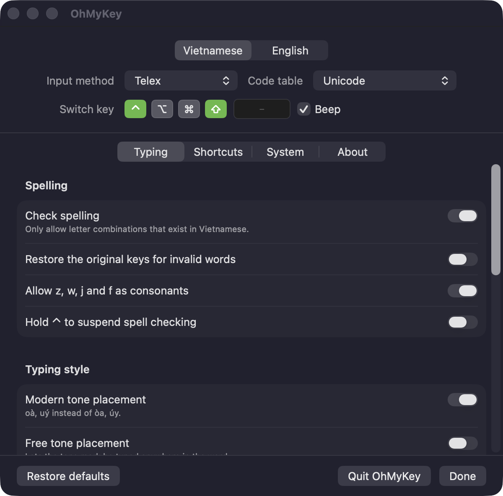
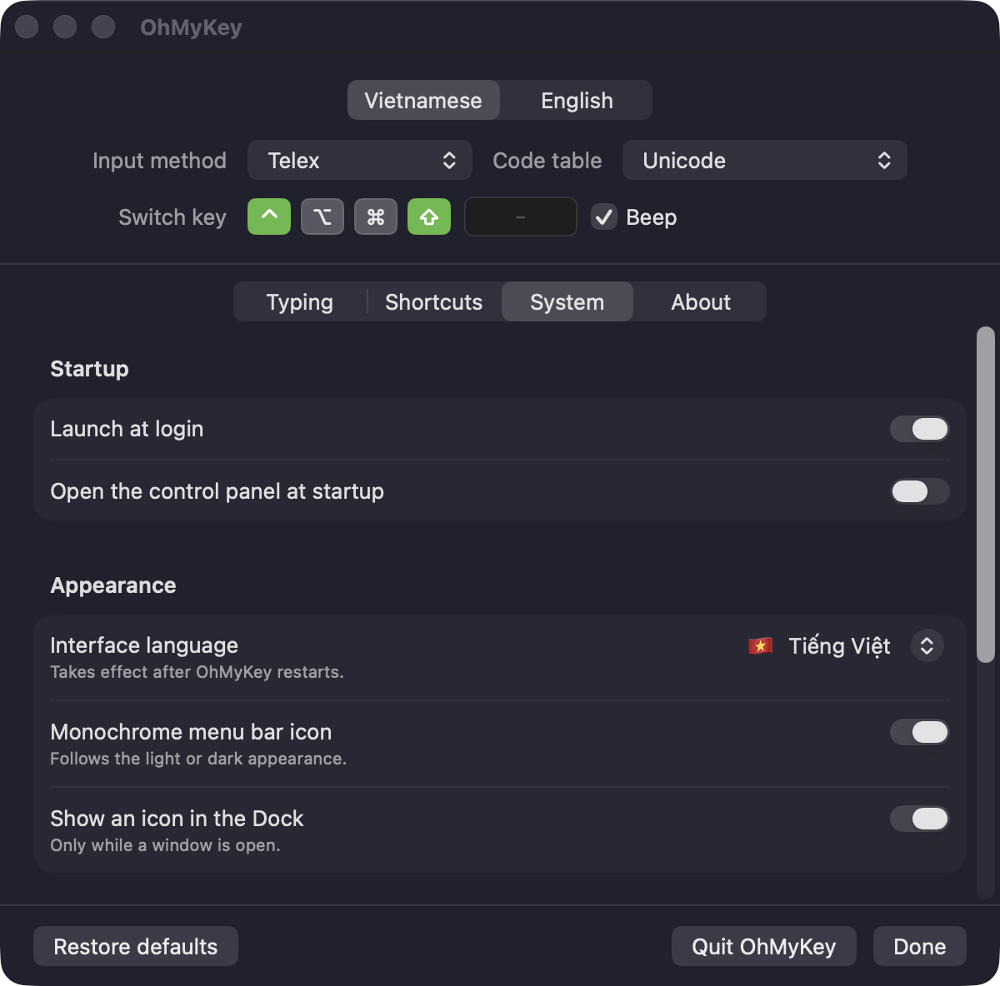
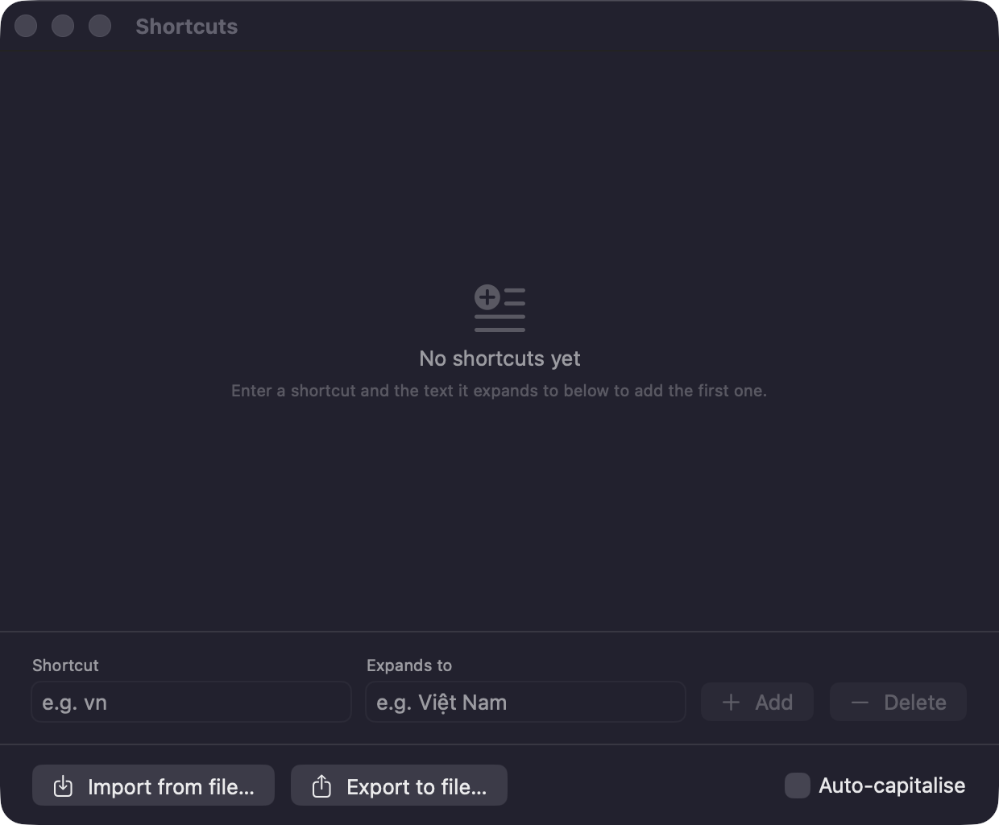
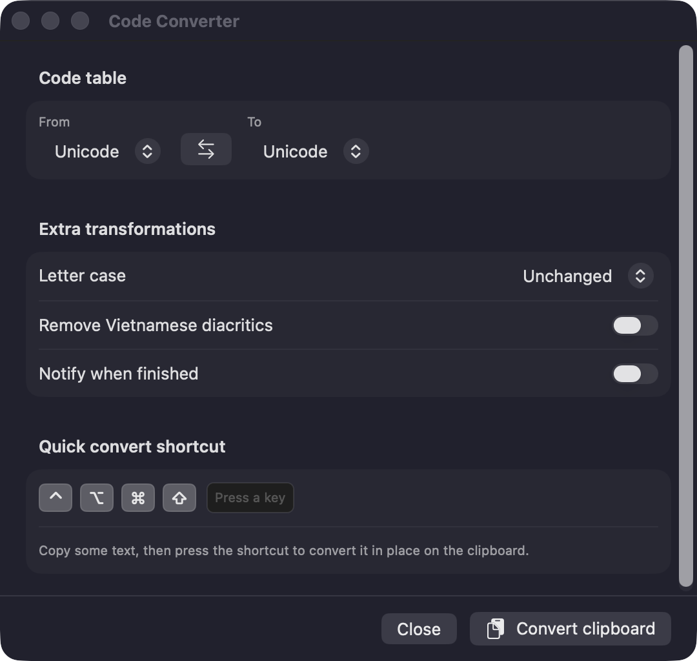

<div align="center">


# OhMyKey

**A Vietnamese input method for macOS.**

A fork of [OpenKey](https://github.com/tuyenvm/OpenKey) with the macOS interface rebuilt in SwiftUI,
translated into English, and a few rough edges sanded off.

[](#requirements)
[](LICENSE)
[](https://github.com/tuyenvm/OpenKey)

[Tiếng Việt](README.vi.md) · [Install](#install) · [Build](#build-from-source) · [What this fork changes](#what-this-fork-changes)



</div>

---

## What this fork changes

The Vietnamese typing engine is OpenKey's, unchanged. Everything below is on the macOS side.

|                                      |                                                                                                                                                                                                                |
| ------------------------------------ | -------------------------------------------------------------------------------------------------------------------------------------------------------------------------------------------------------------- |
| **Interface rebuilt in SwiftUI**     | The old storyboard hard-coded frames for 118 controls, so long Vietnamese labels were truncated mid-word and the layout broke at any other font size. All four windows now size themselves from their content. |
| **English and Vietnamese**           | Every string lives in `Localizable.xcstrings`. Pick the interface language in **System → Appearance**: follow the system, Tiếng Việt, or English.                                                              |
| **A control panel, not a tab box**   | The panel uses a segmented picker instead of `TabView`, which removed macOS's box-inside-a-box.                                                                                                                |
| **New icons**                        | App icon and menu bar icon share one rounded-square motif with the letter knocked out, set in SF Rounded.                                                                                                      |
| **The Dock icon behaves**            | Closing the last window (⌘W) removes the icon from the Dock instead of leaving it stranded there.                                                                                                              |
| **Your OpenKey settings carry over** | On first run, every option, macro and smart-switch entry is copied across. OpenKey's own settings are left untouched.                                                                                          |
| **Tests and scripts**                | Unit tests for the hotkey format and the macro store, plus one-command build, UI preview and test scripts.                                                                                                     |

## Features

**Input methods** — Telex · VNI · Simple Telex 1 · Simple Telex 2

**Code tables** — Unicode · TCVN3 (ABC) · VNI Windows · Unicode Compound · Vietnamese Locale CP 1258

| Area               | What you get                                                                                                                                                         |
| ------------------ | -------------------------------------------------------------------------------------------------------------------------------------------------------------------- |
| **Spelling**       | Restrict typing to combinations that exist in Vietnamese, restore the original keys for invalid words, allow `z w j f` as consonants, or hold ⌃ to suspend checking. |
| **Typing style**   | Modern tone placement (oà, uý), free tone placement, auto-capitalise sentences, quick consonants (`cc→ch`, `gg→gi`, `tt→th`, …).                                     |
| **Mode switching** | A configurable switch key, smart switch that remembers the mode per app, per-app code tables, and hold ⌘ to suspend Vietnamese.                                      |
| **Shortcuts**      | Unlimited-length text expansion (macOS's own is capped at 20 characters), auto-capitalisation, import/export, plus consonant shorthands (`f→ph`, `g→ng`, …).         |
| **Code converter** | Convert the clipboard between code tables, optionally stripping diacritics or changing letter case, bound to a hotkey.                                               |
| **Compatibility**  | Fixes for browser autocomplete, Chromium-based browsers, and non-QWERTY layouts such as Dvorak and Colemak.                                                          |

<details>
<summary><b>More screenshots</b></summary>
<br>

| Interface language and appearance                            | Text shortcuts                                               |
| ------------------------------------------------------------ | ------------------------------------------------------------ |
|  |  |

<p align="center"></p>

</details>

## Requirements

- macOS 13 (Ventura) or later — the SwiftUI rewrite sets the floor.
- Accessibility permission, which is how the app reads and rewrites keystrokes.
- No other Vietnamese input method running. Two of them fight over every keystroke.

## Install

No binary release is published yet, so build it yourself — it takes one command:

```bash
git clone https://github.com/hungdoansy/OhMyKey.git
cd OhMyKey/Sources/OhMyKey/macOS
./scripts/build-and-install.sh
open -a OhMyKey
```

That builds Release and installs to `/Applications/OhMyKey.app`.

Then grant permission in **System Settings → Privacy & Security → Accessibility** and enable
`OhMyKey.app`. Leave it enabled — the app stops working the moment it is switched off.

> **The permission will not stick across rebuilds.** macOS ties the Accessibility grant to the
> app's signature, and a self-built app is only ad-hoc signed, so every build is a new identity.
> If a freshly built app quits the instant it opens:
>
> ```bash
> tccutil reset Accessibility com.hungdoansy.ohmykey
> open -a OhMyKey
> ```
>
> Signing with a real Developer ID certificate makes the grant survive rebuilds.

## Build from source

Requires Xcode 14 or later. Beyond the install script above:

```bash
cd Sources/OhMyKey/macOS

./scripts/build-and-install.sh Debug   # Debug build into /Applications
./scripts/preview-ui.sh                # screenshot all four windows, no permission needed
./scripts/preview-ui.sh --lang en      # …in English
./scripts/run-tests.sh                 # unit tests
```

`preview-ui.sh` runs the app under `OMK_UI_ONLY=1`, which skips the permission gate, the event tap
and the single-instance check. It draws its windows next to the copy you actually type with and
types nothing itself — which is how you iterate on the UI without re-granting Accessibility every
build.

Building through Xcode's own **Product → Archive** works too; see [macOS_Build.md](macOS_Build.md).

## Project layout

| Path                     |                                                                                                |
| ------------------------ | ---------------------------------------------------------------------------------------------- |
| `Sources/OhMyKey/engine` | The cross-platform C++ typing engine, from OpenKey.                                            |
| `Sources/OhMyKey/macOS`  | The macOS app: Objective-C event tap and manager, SwiftUI interface under `OhMyKey/UI`.        |
| `Sources/OhMyKey/win32`  | Windows build, inherited from OpenKey. This fork only renamed it and added settings migration. |
| `Sources/OhMyKey/linux`  | Linux build, inherited from OpenKey and still unfinished.                                      |
| `docs/solutions`         | Notes on problems hit while working on this fork, and why they were solved that way.           |

## Credits

- **OpenKey** — the engine and the original app, by Mai Vũ Tuyên: [tuyenvm/OpenKey](https://github.com/tuyenvm/OpenKey).
- **OhMyKey** — this fork, by [hungdoansy](https://github.com/hungdoansy).

Bug reports and suggestions: [GitHub Issues](https://github.com/hungdoansy/OhMyKey/issues) ·
[Changelog](CHANGELOG.md)

## License

GPL v3, inherited from OpenKey. You can read the source, build it, and change it. If you
redistribute a modified version it must also be open source and must credit OpenKey as the
original. See [LICENSE](LICENSE).
