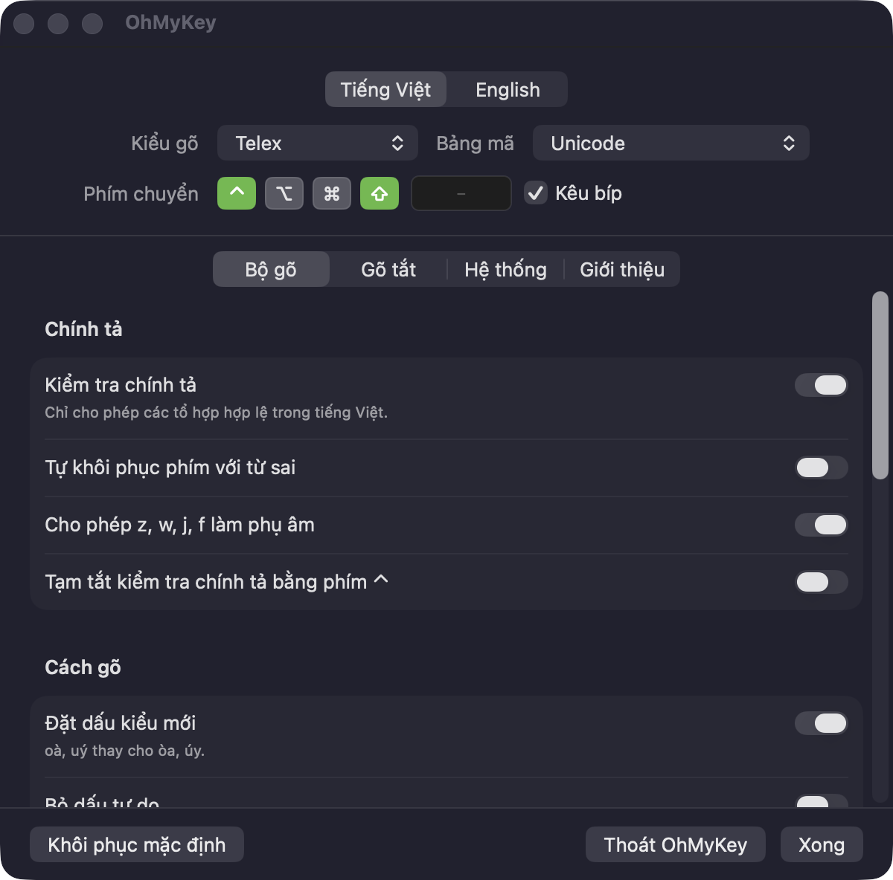
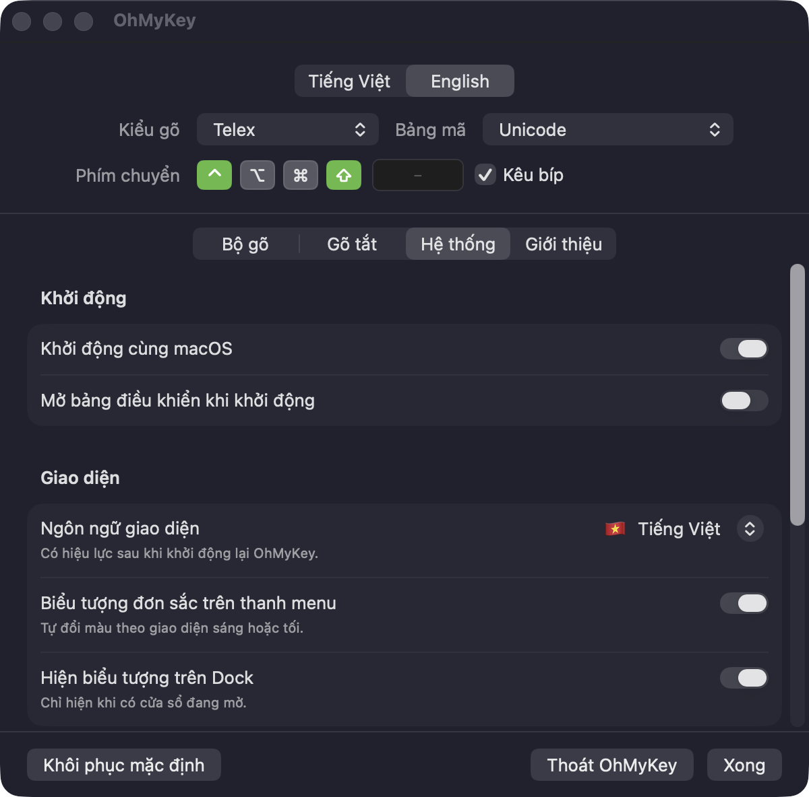
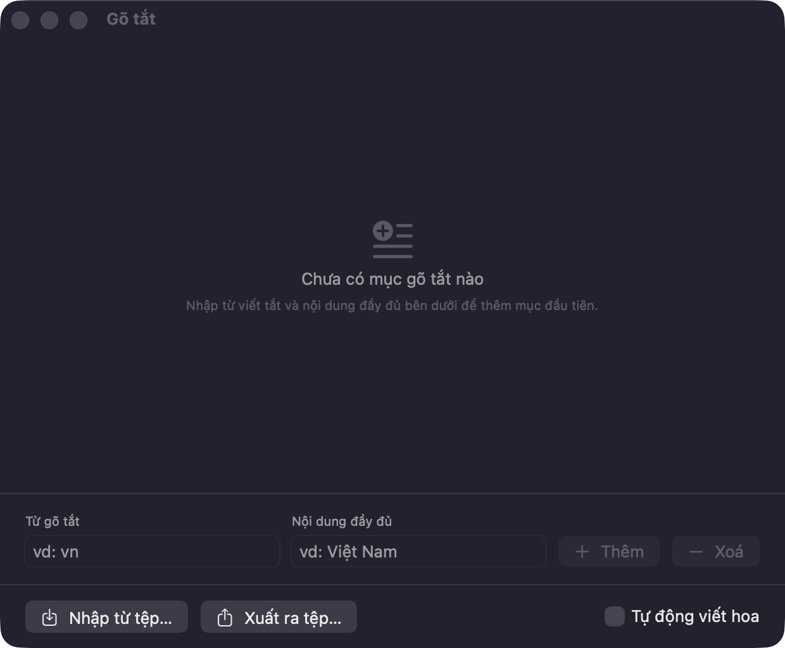
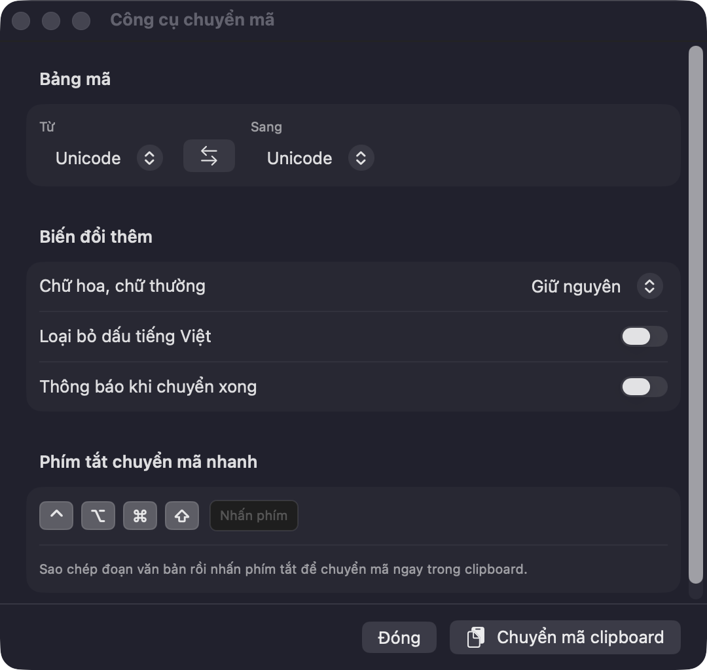

<div align="center">


# OhMyKey

**Bộ gõ tiếng Việt cho macOS.**

Bản fork của [OpenKey](https://github.com/tuyenvm/OpenKey) với giao diện macOS được viết lại bằng
SwiftUI, có thêm tiếng Anh và dọn lại vài chỗ còn gợn.

[](#yêu-cầu)
[](LICENSE)
[](https://github.com/tuyenvm/OpenKey)

[English](README.md) · [Cài đặt](#cài-đặt) · [Tự build](#tự-build-từ-mã-nguồn) · [Fork này khác gì](#fork-này-khác-gì)



</div>

---

## Fork này khác gì

Bộ máy gõ tiếng Việt vẫn là của OpenKey, không đụng tới. Những thay đổi dưới đây đều nằm ở phần macOS.

|                                     |                                                                                                                                                                  |
| ----------------------------------- | ---------------------------------------------------------------------------------------------------------------------------------------------------------------- |
| **Giao diện viết lại bằng SwiftUI** | Storyboard cũ đặt cứng toạ độ cho 118 control, nên nhãn tiếng Việt dài bị cắt giữa chừng và bố cục vỡ ở cỡ chữ khác. Cả bốn cửa sổ giờ tự co giãn theo nội dung. |
| **Song ngữ Việt – Anh**             | Toàn bộ chuỗi hiển thị nằm trong `Localizable.xcstrings`. Chọn ngôn ngữ ở **Hệ thống → Giao diện**: theo hệ thống, Tiếng Việt hoặc English.                      |
| **Bảng điều khiển gọn hơn**         | Dùng segmented picker thay cho `TabView`, bỏ được cái khung lồng trong khung của macOS.                                                                          |
| **Biểu tượng mới**                  | Icon ứng dụng và icon thanh menu cùng một mô-típ bo góc vuông, chữ khoét rỗng, đặt bằng SF Rounded.                                                              |
| **Icon Dock ẩn đúng lúc**           | Đóng cửa sổ cuối cùng (⌘W) là icon biến khỏi Dock, thay vì nằm lại đó như trước.                                                                                 |
| **Giữ nguyên cài đặt OpenKey**      | Lần chạy đầu, mọi tuỳ chọn, gõ tắt và bảng smart switch được chép sang. Cài đặt của OpenKey vẫn còn nguyên.                                                      |
| **Có test và script**               | Unit test cho định dạng phím tắt và kho gõ tắt, kèm script build, xem giao diện và chạy test bằng một lệnh.                                                      |

## Tính năng

**Kiểu gõ** — Telex · VNI · Simple Telex 1 · Simple Telex 2

**Bảng mã** — Unicode · TCVN3 (ABC) · VNI Windows · Unicode tổ hợp · Vietnamese Locale CP 1258

| Nhóm              | Nội dung                                                                                                                                       |
| ----------------- | ---------------------------------------------------------------------------------------------------------------------------------------------- |
| **Chính tả**      | Chỉ cho phép các tổ hợp có thật trong tiếng Việt, tự khôi phục phím với từ sai, cho phép `z w j f` làm phụ âm, hoặc giữ ⌃ để tạm tắt kiểm tra. |
| **Cách gõ**       | Đặt dấu kiểu mới (oà, uý), bỏ dấu tự do, viết hoa đầu câu, gõ nhanh phụ âm (`cc→ch`, `gg→gi`, `tt→th`, …).                                     |
| **Chuyển chế độ** | Phím chuyển tuỳ chọn, chuyển chế độ thông minh theo từng ứng dụng, ghi nhớ bảng mã theo ứng dụng, giữ ⌘ để tạm tắt tiếng Việt.                 |
| **Gõ tắt**        | Không giới hạn độ dài (gõ tắt của macOS chỉ 20 ký tự), tự viết hoa theo phím tắt, nhập/xuất ra file, kèm gõ tắt phụ âm (`f→ph`, `g→ng`, …).    |
| **Chuyển mã**     | Chuyển nội dung clipboard qua lại giữa các bảng mã, có thể bỏ dấu hoặc đổi kiểu chữ hoa thường, gán được phím tắt.                             |
| **Tương thích**   | Sửa lỗi gợi ý của trình duyệt và Excel, lỗi trên trình duyệt nhân Chromium, và các layout không phải QWERTY như Dvorak, Colemak.               |

<details>
<summary><b>Thêm ảnh chụp màn hình</b></summary>
<br>

| Ngôn ngữ và giao diện                                             | Gõ tắt                                                       |
| ----------------------------------------------------------------- | ------------------------------------------------------------ |
|  |  |

<p align="center"></p>

</details>

## Yêu cầu

- macOS 13 (Ventura) trở lên — giao diện SwiftUI đặt mức sàn này.
- Quyền Accessibility, vì ứng dụng cần đọc và viết lại từng phím gõ.
- Không chạy bộ gõ tiếng Việt nào khác. Hai bộ gõ cùng lúc sẽ tranh nhau từng phím.

## Cài đặt

Fork này chưa phát hành bản build sẵn, nên bạn tự build — chỉ một lệnh:

```bash
git clone https://github.com/hungdoansy/OhMyKey.git
cd OhMyKey/Sources/OhMyKey/macOS
./scripts/build-and-install.sh
open -a OhMyKey
```

Script build bản Release rồi cài thẳng vào `/Applications/OhMyKey.app`.

Sau đó vào **System Settings → Privacy & Security → Accessibility** và bật `OhMyKey.app`. Đừng tắt
nó khi đang dùng, vì tắt là ứng dụng ngừng hoạt động ngay.

> **Quyền sẽ mất sau mỗi lần build lại.** macOS gắn quyền Accessibility với chữ ký của ứng dụng, mà
> bản tự build chỉ được ký ad-hoc nên mỗi lần build là một danh tính mới. Nếu ứng dụng vừa mở đã
> tắt ngay:
>
> ```bash
> tccutil reset Accessibility com.hungdoansy.ohmykey
> open -a OhMyKey
> ```
>
> Ký bằng chứng chỉ Developer ID thật thì quyền sẽ giữ nguyên qua các lần build.

## Tự build từ mã nguồn

Cần Xcode 14 trở lên. Ngoài script cài đặt ở trên:

```bash
cd Sources/OhMyKey/macOS

./scripts/build-and-install.sh Debug   # build Debug rồi cài vào /Applications
./scripts/preview-ui.sh                # chụp ảnh cả bốn cửa sổ, không cần cấp quyền
./scripts/preview-ui.sh --lang en      # …bản tiếng Anh
./scripts/run-tests.sh                 # chạy unit test
```

`preview-ui.sh` chạy ứng dụng với `OMK_UI_ONLY=1`, bỏ qua phần xin quyền, bỏ qua event tap và bỏ
qua kiểm tra "đã chạy rồi". Nó vẽ cửa sổ song song với bản bạn đang gõ và không gõ được gì — nhờ
vậy bạn sửa giao diện mà không phải cấp lại quyền sau mỗi lần build.

Build bằng **Product → Archive** trong Xcode cũng được, xem [macOS_Build.md](macOS_Build.md).

## Cấu trúc dự án

| Đường dẫn                |                                                                                                            |
| ------------------------ | ---------------------------------------------------------------------------------------------------------- |
| `Sources/OhMyKey/engine` | Bộ máy gõ viết bằng C++, dùng chung mọi nền tảng, lấy từ OpenKey.                                          |
| `Sources/OhMyKey/macOS`  | Ứng dụng macOS: phần event tap và manager viết bằng Objective-C, giao diện SwiftUI nằm trong `OhMyKey/UI`. |
| `Sources/OhMyKey/win32`  | Bản Windows, kế thừa từ OpenKey. Fork này chỉ đổi tên và thêm phần chuyển cài đặt cũ.                      |
| `Sources/OhMyKey/linux`  | Bản Linux, kế thừa từ OpenKey và vẫn còn dang dở.                                                          |
| `docs/solutions`         | Ghi chú các vấn đề đã gặp khi làm fork này, và lý do chọn cách xử lý đó.                                   |

## Tác giả

- **OpenKey** — bộ máy gõ và ứng dụng gốc, do Mai Vũ Tuyên phát triển: [tuyenvm/OpenKey](https://github.com/tuyenvm/OpenKey).
- **OhMyKey** — bản fork này, do [hungdoansy](https://github.com/hungdoansy) thực hiện.

Báo lỗi và góp ý: [GitHub Issues](https://github.com/hungdoansy/OhMyKey/issues) ·
[Changelog](CHANGELOG.md)

## Giấy phép

GPL v3, kế thừa từ OpenKey. Bạn hoàn toàn có thể đọc mã nguồn, tự build và sửa theo ý mình. Nếu
bạn tái phân phối bản đã sửa thì nó cũng phải là mã nguồn mở và phải ghi rõ bản gốc là OpenKey.
Xem [LICENSE](LICENSE).
